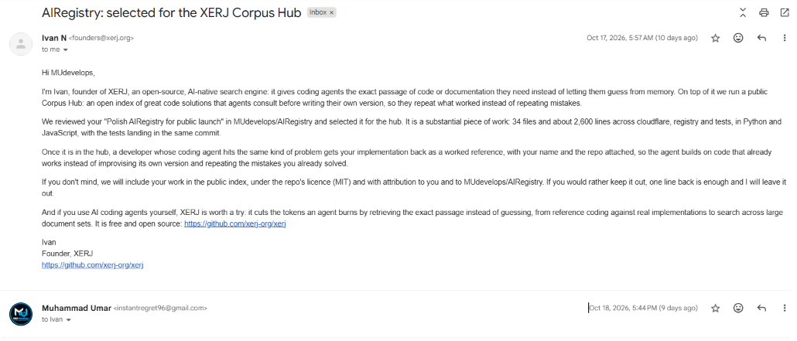
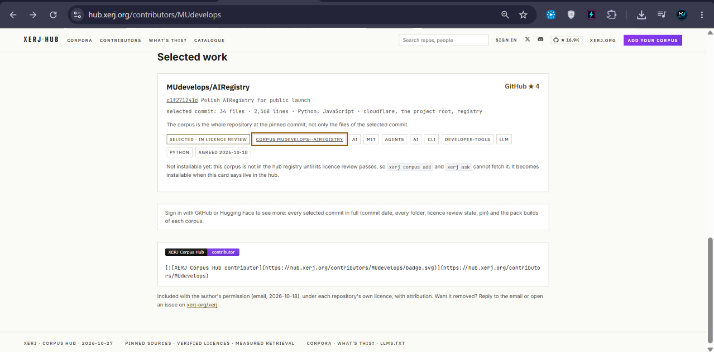
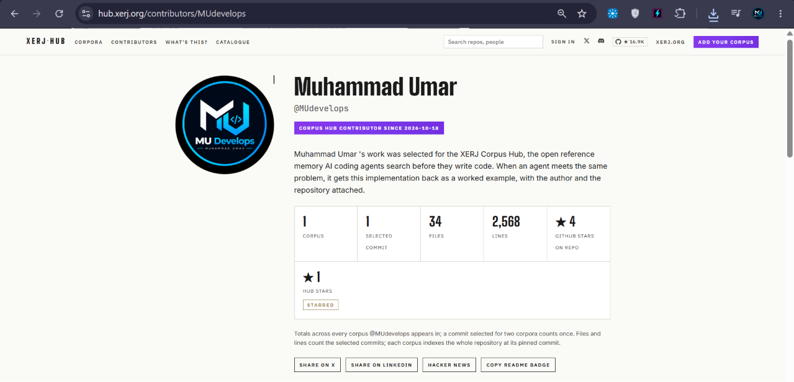
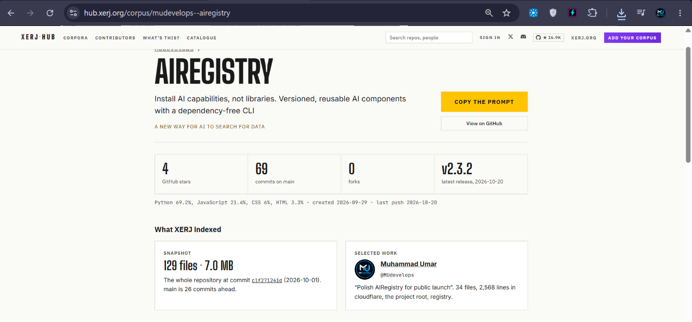

 

**My AI project, [AIRegistry](https://github.com/MUdevelops/AIRegistry), was reviewed and selected by the founder of [XERJ](https://github.com/xerj-org/xerj) for the open Corpus Hub that AI coding agents search before they write code.**

On **October 17, 2026**, Ivan, founder of **XERJ**, an open-source, AI-native search engine for coding agents, emailed me. After reviewing my commit **"Polish AIRegistry for public launch"**, he selected it for the **XERJ Corpus Hub**.

The hub is a public index of strong code solutions. When a developer's coding agent hits a similar problem, it gets my implementation back as a worked reference, **with my name and the repo attached**.

| | |
|---|---|
| **Project** | [MUdevelops/AIRegistry](https://github.com/MUdevelops/AIRegistry): *Install AI capabilities, not libraries.* |
| **Selected work** | `c1f2712`, "Polish AIRegistry for public launch" |
| **Size** | 34 files, 2,568 lines (Python + JavaScript), tests landing in the same commit |
| **Where** | `cloudflare/`, `registry/`, tests, and the project root |
| **Licence** | MIT, with credit. I agreed by email on 2026-10-18 |
| **Hub page** | [hub.xerj.org/corpus/mudevelops--airegistry](https://hub.xerj.org/corpus/mudevelops--airegistry) |
| **Contributor page** | [hub.xerj.org/contributors/MUdevelops](https://hub.xerj.org/contributors/MUdevelops) |

> **Status note:** the hub lists the corpus as *selected, in licence review*. It becomes installable once the hub card says **live**. I'll update this line when it does.

The selection came as a personal email from the founder, not an automated notice.

Subject: <b>AIRegistry: selected for the XERJ Corpus Hub</b> · from founders@xerj.org · Oct 17, 2026 · click to enlarge

Subject: <b>Selected Work</b> · For XERJ Corpus Hub · click to enlarge

The line that matters most to me:

> *"We reviewed your 'Polish AIRegistry for public launch' in MUdevelops/AIRegistry and selected it for the hub. It is a substantial piece of work: 34 files and about 2,600 lines across cloudflare, registry and tests, in Python and JavaScript, with the tests landing in the same commit."*

Two public pages on the XERJ Corpus Hub confirm it. Click either screenshot to open the live page.

<b>Contributor page.</b> Corpus Hub contributor since 2026-10-18. Click to open the live page.

  

<b>Corpus page.</b> MUdevelops/AIRegistry, selected for the hub. Click to open the live page.

About three weeks passed between the first commit and the selection.

- **Ship the tests with the code.** XERJ called out that the tests landed in the same commit. That habit made the work reviewable.
- **A dependency-free CLI is a feature.** AIRegistry's `ai` command runs on plain Python, so installing a capability never means installing a pile of libraries.
- **Treat launch as its own milestone.** The selected commit is the polish pass: docs, structure, release hygiene, security. Polish is what makes code reusable by others.
- **Security is part of the product.** GitHub OAuth with PKCE, signed expiring sessions, and a GitHub App that turns submissions into pull requests.
- **Release properly.** Published to PyPI through Trusted Publishing, with tagged GitHub releases.

| | |
|---|---|
| GitHub | [@MUdevelops](https://github.com/MUdevelops) |
| Portfolio | [m-umar-jamal.netlify.app](https://m-umar-jamal.netlify.app) |
| AIRegistry | [github.com/MUdevelops/AIRegistry](https://github.com/MUdevelops/AIRegistry) |
| Hub profile | [hub.xerj.org/contributors/MUdevelops](https://hub.xerj.org/contributors/MUdevelops) |

If you use AI coding agents, try [XERJ](https://github.com/xerj-org/xerj). It's free, open source, and retrieves the exact passage an agent needs instead of letting it guess.

 

Built by <b>Muhammad Umar Jamal</b> (MUdevelops) · Okara, Pakistan

